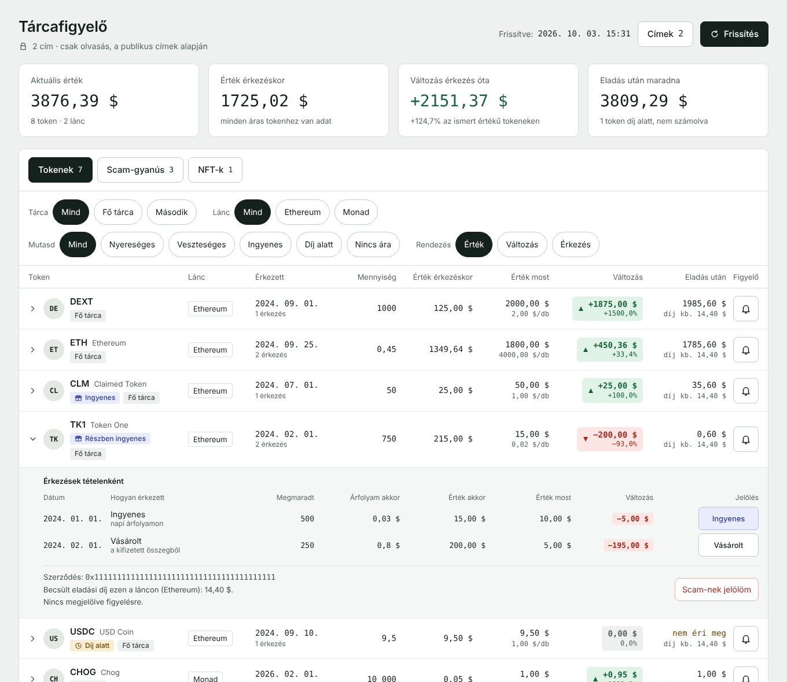

# Tárcafigyelő

Helyben futó, csak olvasó figyelő EVM tárcákhoz. Egy helyen mutatja, mi van a címeiden
több láncon: melyik token mikor és mennyiért érkezett, mennyit ér most, és megéri-e eladni.

Azért készült, mert a tárcák és piacterek felülete időnként elrejt tokeneket, így az
elfelejtett, kis értékű tételeket nehéz észrevenni. Ez a program semmit nem rejt el: a
scam-gyanús tokeneket is megmutatja, csak külön listában.



## Mire jó

- **Minden token egy helyen**, több láncon és legfeljebb 5 címen.
- **Érkezéskori és mostani érték** tokenenként, zöld vagy piros jelöléssel.
- **Ingyenes jelölő:** látszik, mit kaptál ingyen (airdrop, claim) és mit vettél.
- **Díj alatt jelölő:** látszik, ha egy token eladásának díja több, mint amennyit ér.
- **Scam-gyanús tokenek külön lapon**, az indokkal együtt; kézzel át is jelölhetők.
- **NFT-kollekciók** és az eladás utáni töredékek külön listában.

A program csak a publikus címet használja. Privát kulcsot vagy seed phrase-t nem kér, és
tranzakciót nem tud indítani. Az adatok a saját gépeden, egy SQLite fájlban maradnak.

## Mi kell hozzá

- Python 3.8 vagy újabb. Telepíteni nem kell semmit, csak a szabványos könyvtárat használja.
- Egy Alchemy API kulcs. Az ingyenes csomag elég.

## API kulcs létrehozása

Az API kulcsot az Alchemy oldalán lehet létrehozni: <https://www.alchemy.com/>

1. Regisztrálj az Alchemy oldalán, és válaszd az ingyenes (Free) csomagot.
2. Belépés után a dashboardon (<https://dashboard.alchemy.com/>) nyisd meg az appodat,
   vagy hozz létre egyet.
3. Az app oldalán másold ki az **API Key** értékét.
4. Az app **Networks** fülén kapcsold be azokat a láncokat, amelyeket figyelni szeretnél
   (a `config.ini` `[chains]` részében felsoroltakat). Amelyik nincs bekapcsolva, azt a
   program „tiltva" jelzéssel kihagyja.

A kulcsot ne oszd meg senkivel és ne töltsd fel sehova. A program csak a helyi `.env`
fájlból olvassa, és a hibaüzenetekből is kitakarja.

## Telepítés és indítás

```
git clone https://github.com/Pungi9/walletchecker.git
cd walletchecker
cp .env.example .env        # Windows alatt: copy .env.example .env
```

Írd be a kulcsot a `.env` fájlba az `ALCHEMY_API_KEY=` után (csak a kulcsot, nem a teljes
endpoint URL-t), majd indítsd el a felületet:

```
python3 app.py              # Windows alatt: python app.py
```

Nyisd meg a böngészőben: <http://127.0.0.1:8765>

1. A **Címek** gombbal add meg a figyelni kívánt publikus címeket.
2. A **Frissítés** gomb letölti az adatokat. Az első letöltés pár percig tarthat.

Első indításkor a program a `config.example.ini` másolataként létrehozza a `config.ini`
fájlt; a saját beállításaid abban vannak, és az nem kerül fel a repóba.

Telefonról, ugyanazon a Wi-Fin: `python3 app.py --host 0.0.0.0`, majd a telefon böngészőjében
a gép IP-címe és a `:8765`. Így a hálózaton bárki megnyithatja, jelszó nincs rajta.

## A felületen

- **Címek gomb:** cím hozzáadása, átnevezése, törlése. Csak publikus címet fogad el.
- **Tokenek, Scam-gyanús, NFT-k** külön lapon.
- **Sorra kattintva** látszanak az érkezések tételenként. A tétel jobb szélén lévő gombbal
  átjelölheted ingyenesre vagy vásároltra; a kézi jelölést a frissítés nem írja felül.
- **Scam-nek jelölöm / Nem scam:** a token kézzel áttehető a másik listába.
- **Díj alatt:** az eladás becsült díja több, mint amennyit a token ér. A díj becslés:
  a lánc mostani gázára egy átlagos cserére számolva.
- **Csengő:** megjelöli a tokent figyelésre. Értesítést a program még nem küld.

## Parancssorból, felület nélkül

```
python3 fetch.py --probe           # melyik láncon mi érhető el a kulcsoddal (keveset fogyaszt)
python3 fetch.py --only-balances   # csak az aktuális egyenlegek
python3 fetch.py                   # teljes frissítés: egyenleg, mozgások, érkezéskori árak
python3 fetch.py --report          # kiírás a mentett adatokból, API-hívás nélkül
```

További kapcsolók: `--chains eth-mainnet,monad-mainnet` (csak ezek a láncok),
`--retry-prices` (az ár nélkül maradt érkezésekhez újra kér árat).

## Láncok

Alapból ezeket figyeli: Ethereum, Monad, Base, Arbitrum, Optimism, Polygon, BNB Chain, Linea,
Avalanche, Gnosis, Robinhood. A `config.ini` `[chains]` részében törölhetsz belőlük, vagy
felvehetsz újat az Alchemy hálózatnevével.

## Honnan jönnek az adatok

- **Alchemy:** egyenlegek, mozgások, mostani és régi árfolyamok.
- **DexScreener:** mostani ár ott, ahol az Alchemy nem ad (például a Monadon). Kulcs nem
  kell hozzá. A túl kis likviditású párok árát a program nem fogadja el.

## Hogyan sorol be

- **Vásárolt:** ugyanabban a tranzakcióban ki is ment valami a címről. Az érkezéskori
  értéke az, amit ténylegesen fizettél érte.
- **Ingyenes:** token érkezett úgy, hogy semmi nem ment ki (airdrop, claim, ajándék).
- **Átutalás:** a lánc saját coinja vagy stabilcoin érkezett úgy, hogy semmi nem ment ki.
  Ezt nem jelöli ingyenesnek; az érkezés napjának árfolyamán számol.
- **Saját címről:** a feladó egy másik figyelt címed.
- **Scam-gyanús:** link van a nevében, vagy nincs ára és kéretlenül érkezett, vagy
  csalogató a neve és nincs ára. Amiért fizettél, azt soha nem jelöli scamnek.

## Amit még nem tud

- A régi árfolyamok napi felbontásúak. A Monadon token címe alapján nincs ártörténet: ott a
  vásárolt tokenek érkezéskori értéke a kifizetett MON-ból számolódik, az ingyen kapott
  tokeneké pedig „nincs adat" marad.
- Hídon (bridge) át érkező tokent ingyenesnek néz, mert azon a láncon semmi nem ment ki.
- A saját címek közti átutalást felismeri, de az eredeti vételi árat még nem viszi tovább.
- Részleges eladásnál a legrégebbi tételt tekinti eladottnak (FIFO).
- A tranzakciós díjakat nem látja külön: a lánc saját coinjánál az egyenleghez igazítja a
  tételeket.
- NFT-knél csak a darabszámot mutatja, értéket nem.
- A figyelő (csengő) egyelőre csak megjelöl, értesítést nem küld.

Az értékek és díjak becslések, nem pénzügyi tanács. Eladás előtt mindig ellenőrizd az
aktuális árat és díjat ott, ahol a cserét végzed.

## Fájlok

| Fájl | Mire való |
|---|---|
| `app.py` | a helyi webes felület szervere |
| `fetch.py` | adatlekérés, besorolás, árak, kiértékelés |
| `web/index.html` | a felület |
| `config.example.ini` | a beállítások mintája (láncok, keret) |
| `.env.example` | a kulcs helyének mintája |
| `test_fetch.py` | próbák |

A `.env`, a `config.ini` és a `tarca.sqlite3` a saját adataid; a `.gitignore` gondoskodik
róla, hogy ne kerüljenek fel.

## Próbák

```
python3 -m unittest -v test_fetch
```

Hálózat és kulcs nélkül fut, szimulált válaszokkal.
